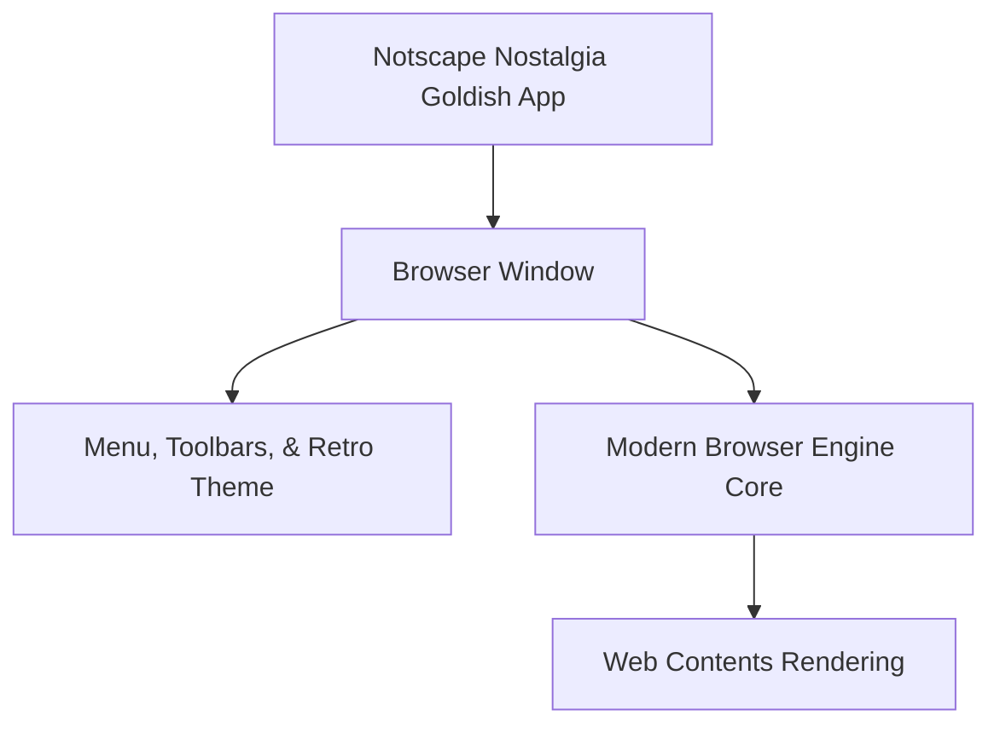

# Notscape Nostalgia Gold(ish) Documentation Index

> [!IMPORTANT]
> **AI Created:** This project was created entirely using the **Antigravity** AI assistant. The user has not touched the code at all.
> 
> **Disclaimer:** The creator is not affiliated with Netscape or any of its affiliates. This is a just-for-fun project.
> 
> **Purpose & Security Warning:** Its purpose is purely for nostalgia. It should **not** be used on a production machine, and it should **not** be trusted with anything secure.
> 
> Have Fun and Stay Safe!

Welcome to the planning and architecture documentation for **Notscape Nostalgia Gold(ish)** — a modern, nostalgic remake of Netscape Navigator Gold 3.0. 

The goal of this project is to recreate the iconic look and feel of the mid-90s browsing experience (specifically the Netscape 3.0 suite) using modern web technologies, running on a robust modern browser engine capable of rendering the 2026 web.

## Document Directory

This planning suite consists of the following detailed documents:

1. **[architecture.md](docs/architecture.md)** — **Browser Engine and Platform Specification**
   - Analysis of browser core options (Electron, Tauri, Web Simulator).
   - Platform architecture, subprocess division, and security structure.
2. **[ui_ux_spec.md](docs/ui_ux_spec.md)** — **Interface Layout and Visual Design**
   - Retro styling system (Windows 95 bevels, palettes, typography).
   - Detailed specifications for the Menu Bar, Toolbar, Location Bar, Directory Buttons, Status Bar, and the classic animated Netscape logo throbber.
3. **[settings.md](docs/settings.md)** — **Settings and Preferences**
   - Configurable nostalgic features (homepage options, history length, startup settings, appearance adjustments).
   - Data persistence strategy.

## High-Level Concept



---

## Key Features

*   **Windows 95 Aesthetics:** Outline-drawn menus, beveled gray frames, legacy Times New Roman fallbacks, custom retro scrollbars, and dynamic security padlock icons that open/close depending on HTTP/HTTPS connections.
*   **Netscape Gold 3 Splash Card:** Spawns a vertical 2:3 splash window on startup featuring glowing aquamarine gradients, green constellation overlays, replica "N" logo globe boxes, a backlit helmsman's wheel, and a comical parody copyright notice. Double-clicks, keyboard presses, or clicking the tiny Close button dismisses it early.
*   **Star-Meteor Throbber:** The upper-right "N" logo dynamically pulses and triggers a looping diagonal meteor shower (red, orange, and white trails) while pages are loading.
*   **Built-in Ad-Blocker (EasyList Lite):** Inspects incoming page requests at the session level and blocks common ad networks, telemetry trackers, and metrics hooks (e.g. DoubleClick, Chartbeat, Facebook Pixel, Google Tag Manager).
*   **General Preferences Panel:** A tab-style settings card to toggle toolbar displays (Pictures & Text, Icons-only, Text-only), clear history logs, modify home page locations, and enable/disable the ad blocker. Saves config updates locally to `preferences.json`.
*   **Native Multi-Window Spawning:** Selecting `File -> New Web Browser` triggers isolated child windows that handle context isolation, user agents, protocol registries, and window operations independently.

---

## Retro Tech Stack Choice

- **App Shell Framework:** Electron
- **Browser Engine:** Chromium (via Electron's `<webview>` API)
- **UI Architecture:** Semantic HTML, CSS3 custom properties (for retro gray shades and 3D bevels), and vanilla ES6+ JavaScript.
- **Data Persistence:** Local JSON-based config files.

---

## How to Run & Build

### Prerequisites
- **Node.js** (v18 or higher recommended)
- **npm** (Node Package Manager)

### Installation
Install the necessary developer dependencies (specifically the Electron framework runtime):
```bash
npm install
```

### Running the Browser (Development Mode)
To spin up the browser skin and connect to the webview core:
```bash
npm start
```

### Packaging for Release (Optional)
To bundle the browser into a standalone desktop application executable (for Windows, macOS, or Linux), you can use packaging tools like `electron-packager` or `electron-builder`:
```bash
# Example using electron-packager
npx electron-packager . NotscapeNostalgiaGoldish --platform=all --arch=x64 --out=dist
```
